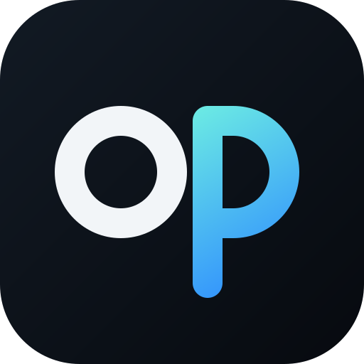
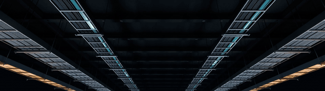
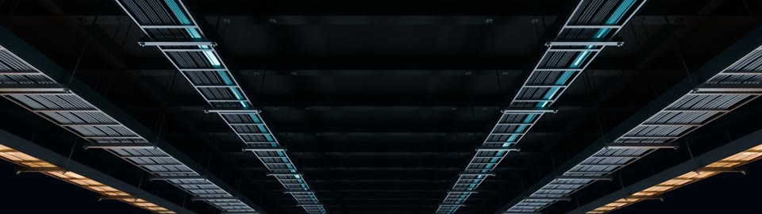
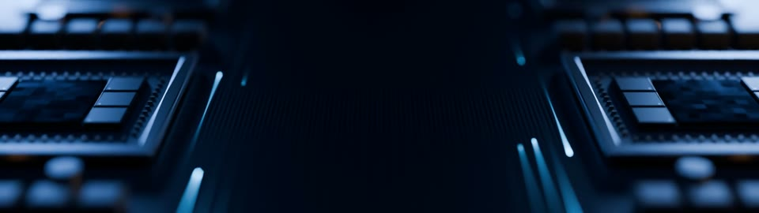
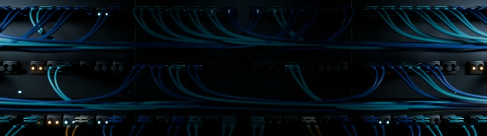
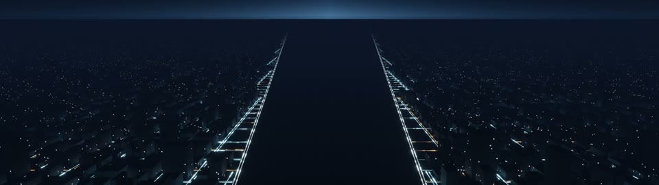
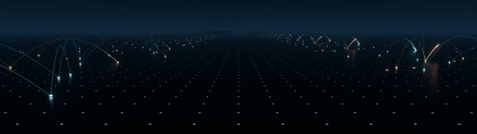
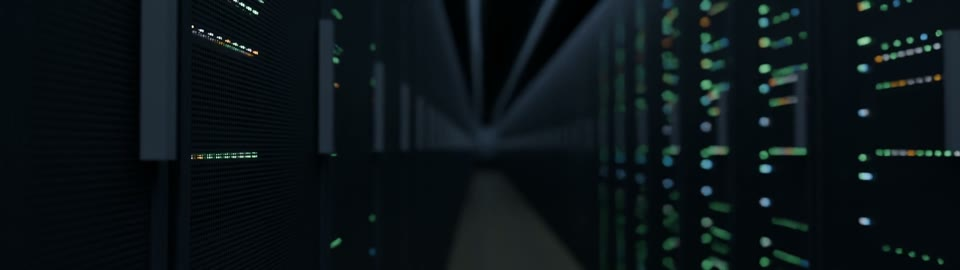

<p align="center"></p>

# banner-loop

[English](README.md) · **한국어**

**코드만으로 만드는 32:9 히어로 배너용 무한 루프 영상.** Blender 씬 스크립트 → Cycles 1920×540 렌더 →
Apple 기기 내장 AI 초해상도(4배) → 3840×1080 MP4. 렌더할 때마다 루프 품질을 수치로 점검합니다.

웹사이트 히어로 배너용으로 만들었습니다. 5초 루프의 이음새가 보이지 않고, HTML 헤드라인이 올라갈 가운데는 어둡고
차분하게 비워 두며, 움직임은 잔잔하고, 영상 안에 글자나 로고가 없습니다.

**[▶ 데모](https://banner-loop-demo.vercel.app)** · [MP4 내려받기](https://github.com/opskill/banner-loop/releases/tag/v0.2.0)



| | |
|---|---|
|  케이블 트레이 |  GPU 매크로 |
|  클라우드 블록 |  IX 허브 |
|  CDN 행성 |  광 패치 패널 |
|  도시 데이터 흐름 |  보안 격자 |
|  도메인 그리드 |  랙 클로즈업 |

| | |
|---|---|
| 씬 | 코드로 만든 컨셉 루프 10종 (`scenes/concept_*.py`) — 광 패치 패널, 케이블 트레이, GPU 매크로, IX 허브, CDN 행성, 도시 데이터 흐름, 클라우드 블록, 보안 격자, 도메인 그리드, 랙 클로즈업 |
| 결과물 | `<key>_5s_1920x540.mp4`, `<key>_5s_3840x1080_sr.mp4`, 콘택트 시트, 품질 수치 |
| 속도 (M2 Pro) | 렌더 프레임당 7–23초 (루프당 17–57분), 업스케일 루프당 약 5분 20초 |
| 업스케일하는 이유 | 3840×1080으로 바로 렌더하면 GPU 시간이 약 4배. 렌더 → AI 4배가 전체로 약 3~3.5배 빠름 |

## 필요한 것

- Apple 실리콘 macOS 26 이상 (업스케일러가 `VTSuperResolutionScalerConfiguration`을 씁니다. 모델은 처음 쓸 때 자동으로 받습니다)
- [Blender](https://www.blender.org/download/) 5.x (5.2 LTS에서 확인), Node.js 20+, ffmpeg, `numpy`·`Pillow`가 있는 Python 3
- Xcode 커맨드라인 도구(`clang`) — 처음 실행할 때 `tools/loop.sh`가 업스케일러를 빌드합니다

렌더는 Blender가 도는 어느 플랫폼에서나 됩니다. 4K 업스케일만 macOS 전용이고, 다른 OS에서는 `--upscale none`을 씁니다.

## 빠른 시작

```bash
git clone https://github.com/opskill/banner-loop && cd banner-loop
npm run assets                       # Poly Haven CC0 텍스처 2종 (케이블 트레이, 랙 클로즈업)
export BLENDER_BIN=/Applications/Blender.app/Contents/MacOS/Blender

tools/loop.sh --scene concept_cable_trays --still 1 --spp 16    # 테스트 한 프레임
tools/loop.sh --scene concept_cable_trays --key 10_cable_trays  # 전체 루프 + 4K + 품질 점검
```

결과는 `out/concepts/video/`에 저장됩니다 (git에는 올라가지 않음).

## `tools/loop.sh` 옵션

| 옵션 | 기본값 | |
|---|---|---|
| `--scene NAME` | 필수 | `scenes/NAME.py` |
| `--key KEY` | 필수 | 출력 이름, 예: `10_cable_trays` |
| `--frames A-B` | `1-150` | 5초 @ 30fps. 일부 구간(예: `40-60`)을 주면 그 프레임만 다시 렌더한 뒤 폴더의 전체 시퀀스로 인코딩/업스케일/점검 (1..N 프레임이 모두 있어야 함). 프레임 폴더를 비우는 건 `--resume` 없이 전체 구간을 줄 때뿐 |
| `--spp N` | `64` | Cycles 샘플 수 (디테일 많은 매크로 씬은 96, 초안은 32) |
| `--chunk N` | `50` | Blender 한 번에 렌더할 프레임 수 |
| `--still F` | – | 한 프레임만 렌더하고 끝 (실패하면 Blender 로그 끝부분을 보여 줌) |
| `--resume` | 꺼짐 | 중단된 뒤 이어서. 다 된 프레임은 두고 빈 자리표시 파일은 다시 렌더 |
| `--upscale 4k\|none` | `4k` (macOS 아니면 `none`) | AI 4배 → 3840×1080 (macOS 26+, `clang`), 또는 1920만 |
| `--no-encode` / `--no-stats` | 꺼짐 | 프레임만 / 품질 점검 생략 |
| `--no-lock` | 꺼짐 | 공유 GPU 잠금 생략 (아래 참고) |
| `--env K=V` | – | 씬이 환경변수로 읽는 조절값 (예: `FIBER_CENTER_FILL=0.6`) |

씬 스크립트를 직접 돌려도 됩니다: `node bin/blender.mjs concept_ix_hub --engine cycles --spp 64 --start 1 --end 50 --out out/x`.

## 동작 방식

**이음새 없는 루프.** 모든 씬은 150프레임 주기입니다. 카메라는 반복 타일(Array 모디파이어)을 정확히 정수 개만큼
이동하고, 펄스도 정수 주기를 쓰며, Cycles 시드는 고정입니다. 애니메이션은 키프레임 대신 `frame`에 거는 **드라이버**로
만듭니다 (Blender 5.2 키프레임은 선형으로 설정해도 가감속이 걸림). 품질 점검에서 이음새 차이(마지막 → 첫 프레임)가
평소 프레임 간 차이와 같은지 확인합니다.

**4배 후 절반.** Apple 고화질 초해상도 스케일러는 4배만 지원하고(입력 최대 1920×1080), 저지연 버전은 2배지만
960×960까지만 받습니다. 그래서 `tools/vtsr`가 1920×540 → 7680×2160으로 키운 뒤 `VTPixelTransferSession`으로
3840×1080으로 줄입니다. 줄이는 과정에서 AI가 만든 가장자리 잡티도 평균되어 사라집니다. 마지막 8프레임을 먼저 흘려
시간축 모델을 데워 두기 때문에 1프레임부터 이음새가 깨끗합니다. 초해상도 모델이 색을 조금 바꾸기 때문에(케이블 트레이에서
파랑 약 −1.8 레벨) 출력 프레임마다 1920 원본 기준으로 저주파 색 보정을 합니다 (평균 차이 0.05 레벨 미만, 디테일은 유지).
두 mp4 모두 BT.709(제한 범위)로 태그됩니다.

**배너 품질 점검** (`tools/loopstats.py [--check] <프레임 폴더>`. `loop.sh`는 1920과 "4K (SR)" 수치를
`<key>_stats.txt`에 씁니다. `--check`는 이음새가 인접 차이의 1.5배 + 0.5보다 크거나, 출렁임이 ±10%를 넘거나,
가운데 p99.9 밝기가 160을 넘으면 1로 끝납니다):

| 지표 | 목표 |
|---|---|
| 이음새 차이 vs 인접 프레임 차이 | 거의 같음 |
| 인접 프레임 평균 차이 (0–255) | 2–3 이하 (잔잔한 움직임) |
| 프레임 평균 밝기 출렁임 | 약 ±8% 이내 |
| 가운데 30% 최대 밝기 | 120 이하 권장 (헤드라인 자리가 차분하게) |

**공유 GPU 잠금.** Blender를 돌릴 때마다 `/tmp/blender_concept.lock`을 잡고(`mkdir`/`rmdir`, 잡은 프로세스 pid는 `pid`에)
구간 사이에 25초 쉬어서, 여러 에이전트나 작업이 GPU 하나를 싸우지 않고 나눠 씁니다. 기다리는 쪽은 누가 잡고 있는지 알려 줍니다.
끝날 때와 Ctrl-C 때 잠금을 풀고, 그래도 잡은 프로세스가 죽은 채 남으면 다음 실행이 넘겨받습니다. pid가 없는 잠금(예전 도구)은
넘겨받지 않으니 Blender 프로세스가 없는 것을 확인한 뒤 지우면 됩니다.

## Claude Code 플러그인으로 설치

이 저장소는 Claude Code 플러그인 마켓플레이스이기도 합니다. 플러그인(`banner-loop`)에는 `banner-loop` 스킬이
들어 있습니다: 파이프라인, 배너 규칙, 리뷰 → 수정 흐름, 에셋 라이선스 규칙.

```bash
claude plugin marketplace add opskill/banner-loop
claude plugin install banner-loop@banner-loop
```

세션 안에서는 `/plugin marketplace add opskill/banner-loop` 다음 `/plugin install banner-loop@banner-loop`.
이후 말로 시키거나 ("케이블 트레이 루프 4K로 렌더해줘", "CDN 아크를 더 차분하게 해서 다시 렌더해줘")
`/banner-loop:banner-loop`으로 부릅니다. 플러그인으로 설치한 경우 결과는 플러그인 캐시가 아니라 지금 작업 중인
프로젝트의 `./out`에 저장됩니다(`BANNER_LOOP_OUT`).

다른 방법:
- **클론해서 열기**: 저장소를 Claude Code로 열면 `.claude/skills/`의 스킬이 자동으로 잡힙니다.
- **직접 복사**: `cp -r skills/banner-loop ~/.claude/skills/` (이 경우 스킬은 이 저장소의 클론이 있다고 가정합니다).
- **한 세션만**: `claude --plugin-dir /path/to/banner-loop`.

업데이트: `claude plugin marketplace update banner-loop`. 제거: `claude plugin uninstall banner-loop@banner-loop`.

## 새 씬 만들기

기존 씬을 복사하고(`concept_cable_trays.py`가 가장 깔끔한 예) `scenes/lib.py`의 헬퍼를 씁니다:
`parse_args`, `reset_scene`, `setup_render`, `make_pbr`, `make_tiled_pbr`, `add_area_light`, `look_at`.
Blender 버전별 차이는 `lib.py` 안에서만 처리합니다.
규칙: 글자·로고 없음, 가운데는 어둡고 차분하게, 루프 동안 정수 주기, 시드 고정.

## 에셋과 라이선스

- 코드: MIT (`LICENSE` 참고).
- 텍스처: [Poly Haven](https://polyhaven.com/license) **CC0**. `npm run assets`가 `assets/manifest.json`을 보고
  내려받으며 저장소에는 넣지 않습니다. 씬의 나머지는 모두 코드로 만든 것입니다.
- 렌더한 영상은 만든 사람의 것입니다. Blender의 GPL은 프로그램에 적용되고 결과물에는 적용되지 않습니다.
- 에셋을 추가할 때: CC0나 상업적 사용이 허용된 라이선스만 쓰고, 출처·라이선스·작가를 `manifest.json`에 적고,
  CC-BY 작품은 영상을 게시하는 곳에 출처를 표기합니다. 유료 마켓 에셋, "개인 사용만", NC/ND, 출처 불명 에셋,
  실제 회사 로고는 쓰지 않습니다.
