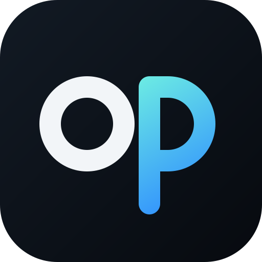
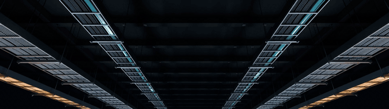
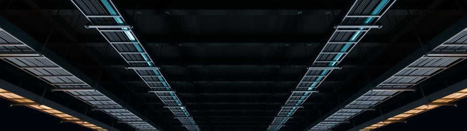
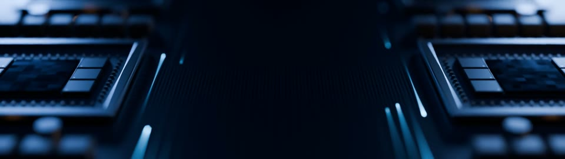
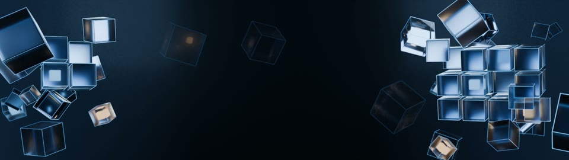
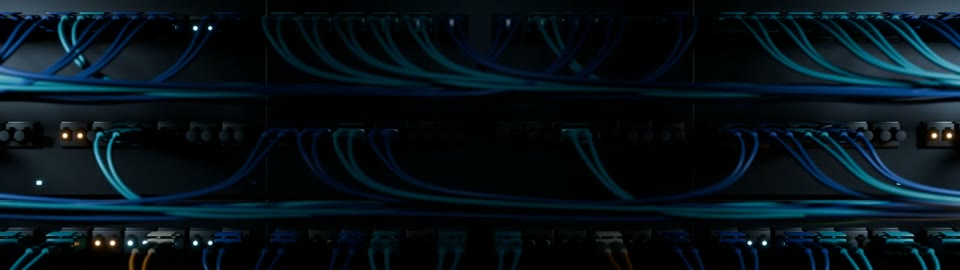
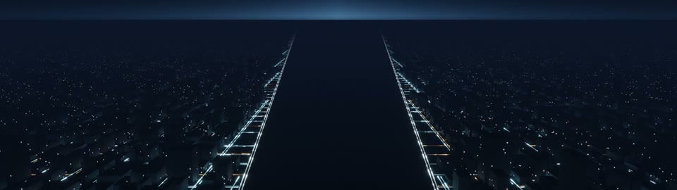
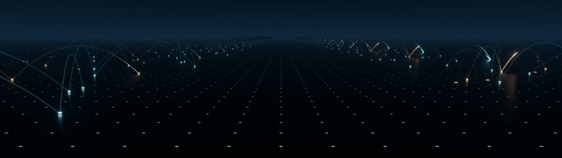
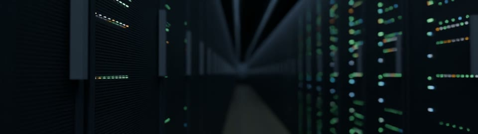

<p align="center"></p>

# banner-loop

**English** · [한국어](README.ko.md)

Seamless **32:9 hero-banner loop videos made entirely from code**: Blender scene scripts → Cycles at 1920×540 →
Apple's on-device AI super-resolution (4×) → 3840×1080 MP4, with loop QC numbers for every render.

Built for website hero banners: 5-second loops that never show a seam, keep the centre dark and calm for an HTML
headline, move gently, and contain no text or logos.

**[▶ Live demo](https://banner-loop-demo.vercel.app)** · [download the MP4s](https://github.com/opskill/banner-loop/releases/tag/v0.2.0)



| | |
|---|---|
|  Cable trays |  GPU macro |
|  Cloud blocks |  IX hub |
|  CDN planet |  Fiber patch panel |
|  City data flow |  Security lattice |
|  Domain grid |  Rack close-up |

| | |
|---|---|
| Scenes | 10 procedural concept loops (`scenes/concept_*.py`) — fibre patch panel, cable trays, GPU macro, IX hub, CDN planet, city data flow, cloud blocks, security lattice, domain grid, rack close-up |
| Output | `<key>_5s_1920x540.mp4`, `<key>_5s_3840x1080_sr.mp4`, contact sheet, QC stats |
| Speed (M2 Pro) | render 7–23 s/frame (17–57 min per loop), upscale ≈ 5 min 20 s per loop |
| Why upscale | rendering 3840×1080 directly costs ~4× the GPU time; render → AI 4× is ~3–3.5× faster end to end |

## Requirements

- macOS 26+ on Apple silicon (the upscaler uses `VTSuperResolutionScalerConfiguration`; the model downloads on first use)
- [Blender](https://www.blender.org/download/) 5.x (tested 5.2 LTS), Node.js 20+, ffmpeg, Python 3 with `numpy` + `Pillow`
- Xcode command line tools (`clang`) — `tools/loop.sh` builds the upscaler on first run

Rendering works on any Blender platform; only the 4K upscale step is macOS-only (`--upscale none` elsewhere).

## Quick start

```bash
git clone https://github.com/opskill/banner-loop && cd banner-loop
npm run assets                       # two CC0 textures from Poly Haven (cable trays, rack close-up)
export BLENDER_BIN=/Applications/Blender.app/Contents/MacOS/Blender

tools/loop.sh --scene concept_cable_trays --still 1 --spp 16    # one test frame
tools/loop.sh --scene concept_cable_trays --key 10_cable_trays  # full loop + 4K + QC
```

Results land in `out/concepts/video/` (gitignored).

## `tools/loop.sh` options

| option | default | |
|---|---|---|
| `--scene NAME` | required | `scenes/NAME.py` |
| `--key KEY` | required | output name, e.g. `10_cable_trays` |
| `--frames A-B` | `1-150` | 5 s @ 30 fps. A partial range (e.g. `40-60`) re-renders only those frames, then encodes/upscales/QCs the whole sequence (frames 1..N must all exist); only a full range without `--resume` clears the frames folder |
| `--spp N` | `64` | Cycles samples (96 for fine-detail macro scenes, 32 for drafts) |
| `--chunk N` | `50` | frames per Blender run |
| `--still F` | – | render a single frame and stop (on failure the end of the Blender log is printed) |
| `--resume` | off | continue after a crash; keeps finished frames, re-renders empty placeholders |
| `--upscale 4k\|none` | `4k` (`none` off macOS) | AI 4× → 3840×1080 (macOS 26+, `clang`), or 1920 only |
| `--no-encode` / `--no-stats` | off | frames only / skip QC |
| `--no-lock` | off | skip the shared GPU lock (see below) |
| `--env K=V` | – | scene knobs read from the environment (e.g. `FIBER_CENTER_FILL=0.6`) |

Scene scripts can also be run directly: `node bin/blender.mjs concept_ix_hub --engine cycles --spp 64 --start 1 --end 50 --out out/x`.

## How it works

**Seamless loops.** Every scene is periodic in 150 frames: the camera travels exactly an integer number of repeating
tiles (Array modifiers), pulses use integer periods, the Cycles seed is fixed. Animation uses **drivers** on `frame`
rather than keyframes (Blender 5.2 keyframes ease even with linear defaults). QC checks that the seam diff (last → first
frame) matches the normal frame-to-frame diff.

**4× then half.** Apple's quality super-resolution scaler only supports 4× (input ≤ 1920×1080); the low-latency variant
does 2× but only up to 960×960. So `tools/vtsr` upscales 1920×540 → 7680×2160 and down-samples to 3840×1080 with
`VTPixelTransferSession`, which also averages away AI edge artefacts. It pre-rolls the last 8 frames so the temporal
model is warmed up at frame 1 and the loop seam stays clean. The SR model shifts colour slightly (blue about −1.8 levels
on cable trays), so each output frame gets a low-frequency colour fix back to the 1920 source (mean difference < 0.05
levels; detail is kept). Both mp4s are tagged BT.709 (limited range).

**Banner QC** (`tools/loopstats.py [--check] <frames_dir>`; `loop.sh` writes the 1920 and the "4K (SR)" numbers to
`<key>_stats.txt`; `--check` exits 1 if the seam is > 1.5× adjacent diff + 0.5, pumping exceeds ±10 % or the centre
p99.9 luma is > 160):

| metric | target |
|---|---|
| seam diff vs adjacent diff | about equal |
| mean adjacent diff (0–255) | ≲ 2–3 (gentle motion) |
| frame-mean pumping | within ~±8 % |
| centre 30 % max luma | ideally < ~120 (headline zone stays calm) |

**Shared GPU lock.** Each Blender run takes `/tmp/blender_concept.lock` (`mkdir`/`rmdir`, holder pid in `pid`) and waits
25 s between chunks, so several agents or jobs can queue on one GPU without fighting. A waiting run prints who holds it.
The lock is released on exit and Ctrl-C; if its holder died anyway, the next run takes it over. A lock without a pid
(older tools) is never taken over: remove it once no Blender process is running.

## Install as a Claude Code plugin

The repo is also a Claude Code plugin marketplace with one plugin (`banner-loop`) that ships the
`banner-loop` skill: the pipeline, the banner rules, a review → fix loop and the asset license rules.

```bash
claude plugin marketplace add opskill/banner-loop
claude plugin install banner-loop@banner-loop
```

or inside a session: `/plugin marketplace add opskill/banner-loop` then `/plugin install banner-loop@banner-loop`.
Then ask in plain words ("render the cable trays loop in 4K", "make the CDN arcs calmer and re-render") or call
`/banner-loop:banner-loop`. From a plugin install, outputs go to `./out` of the project you are in
(`BANNER_LOOP_OUT`), not into the plugin cache.

Other ways to get the skill:
- **Clone and open** the repo in Claude Code — the skill is picked up from `.claude/skills/` automatically.
- **Manual copy**: `cp -r skills/banner-loop ~/.claude/skills/` (the skill then expects a clone of this repo).
- **One session only**: `claude --plugin-dir /path/to/banner-loop`.

Update: `claude plugin marketplace update banner-loop`. Remove: `claude plugin uninstall banner-loop@banner-loop`.

## Writing a new scene

Copy a scene (`concept_cable_trays.py` is the cleanest reference) and use the helpers in `scenes/lib.py`:
`parse_args`, `reset_scene`, `setup_render`, `make_pbr`, `make_tiled_pbr`, `add_area_light`, `look_at`. Keep Blender-version differences inside `lib.py`.
Rules: no text/logos, calm dark centre, integer periods over the loop, fixed seed.

## Assets and licenses

- Code: MIT (see `LICENSE`).
- Textures: [Poly Haven](https://polyhaven.com/license) **CC0**, downloaded by `npm run assets` from
  `assets/manifest.json`; not stored in the repo. Everything else in the scenes is procedural.
- Rendered videos are yours. Blender's GPL covers the program, not its output.
- If you add assets: use CC0 or licenses that allow commercial use, record source/license/author in `manifest.json`,
  credit CC-BY works where the video is published, and never use paid-marketplace, "personal use only", NC/ND,
  or unclear-provenance assets, or real company logos.
